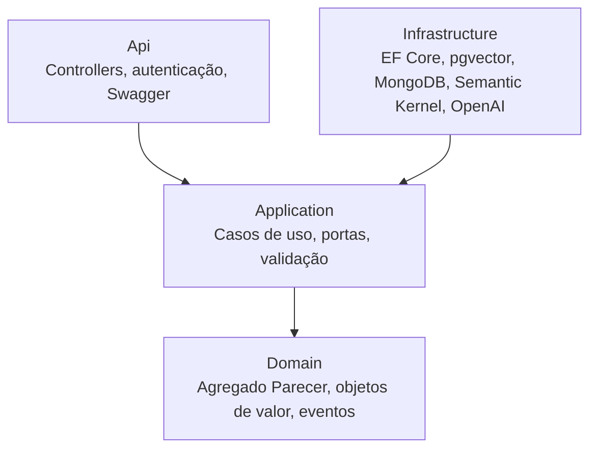
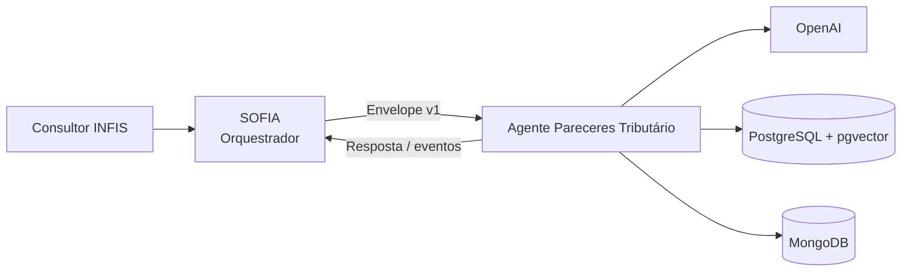

# Agente Pareceres Tributário — INFIS Consultoria

Agente de IA que apoia os consultores da **INFIS Consultoria** na elaboração, revisão e fundamentação de **pareceres tributários**. Ele produz minutas com base em legislação, normas infralegais, soluções de consulta e jurisprudência, sempre com citação rastreável das fontes e **aprovação humana obrigatória**.

O agente será integrado ao **SOFIA**, o orquestrador central de agentes da INFIS, e também poderá ser usado de forma autônoma, com o mesmo contrato.

| | |
|---|---|
| **Organização** | INFIS Consultoria |
| **Responsável** | Roberto |
| **Identificador** | `pareceres-tributario` |
| **Metodologia** | Spec-Driven Development (SDD) |
| **Status** | 🚧 Fase 1 — Fundação segura: estrutura da solution criada, **sem funcionalidades implementadas** |

---

## Sumário

- [O que o agente faz](#o-que-o-agente-faz)
- [Princípios](#princípios)
- [Arquitetura](#arquitetura)
- [Stack tecnológica](#stack-tecnológica)
- [Estrutura do repositório](#estrutura-do-repositório)
- [Como executar](#como-executar)
- [Integração com o SOFIA](#integração-com-o-sofia)
- [Desenvolvimento com SDD](#desenvolvimento-com-sdd)
- [Roadmap](#roadmap)
- [Documentação](#documentação)

---

## O que o agente faz

1. **Recebe uma consulta tributária** estruturada: pergunta, fatos, tributos, esfera (federal, estadual ou municipal), UF/município, período de referência e anexos.
2. **Identifica lacunas**: se faltarem fatos essenciais, devolve perguntas de esclarecimento em vez de presumir.
3. **Pesquisa a base normativa** (RAG) e registra vigência e data de consulta de cada fonte.
4. **Gera a minuta** na estrutura padrão INFIS: Ementa, Consulta, Fatos, Legislação Aplicável, Análise, Conclusão, Ressalvas e Referências.
5. **Valida as citações**: nenhuma afirmação sai sem referência existente na base.
6. **Aguarda a decisão humana**: somente um revisor autorizado aprova ou rejeita o parecer.

### O que o agente **não** faz

- Não assina, emite nem protocola pareceres.
- Não toma decisões finais em nome do consultor ou do cliente.
- Não acessa portais de órgãos públicos nem gera guias de recolhimento.
- Não usa dados de um cliente no atendimento de outro.

## Princípios

Definidos em [`specs/constitution.md`](specs/constitution.md), que prevalece sobre qualquer outro documento:

| Princípio | Resumo |
|---|---|
| **Fundamentação obrigatória** | Toda conclusão tributária cita a base normativa. Sem fonte, a lacuna é declarada. |
| **Humano no controle** | Toda saída é **minuta** até ser aprovada por um profissional. |
| **Isolamento** | Dados segregados por cliente (tenant); execução e credenciais próprias; nenhum estado compartilhado com outros agentes. |
| **Auditoria** | Registro append-only, encadeado por hash, de cada etapa, modelo, prompt e fonte utilizada. |
| **Segurança** | Sigilo profissional, LGPD, menor privilégio, segredos em cofre e defesa contra *prompt injection*. |
| **Integração por contrato** | Comunicação com outros agentes apenas via SOFIA, com contratos versionados (SemVer). |
| **Especificação antes do código** | Nenhum código sem requisito e tarefa correspondentes. |
| **Atualidade normativa** | Data-base da análise e vigência de cada norma sempre registradas. |

## Arquitetura

Clean Architecture com DDD e SOLID. As dependências apontam sempre para dentro, e o domínio não conhece nenhuma tecnologia.



Visão de contexto:



Destaques:

- **Agregado `Parecer`** com máquina de estados: `RASCUNHO` → `AGUARDANDO_ESCLARECIMENTO` → `EM_REVISAO` → `APROVADO` / `REJEITADO` → `ARQUIVADO`.
- **Semantic Kernel** com kernel por requisição, plugins somente leitura e filtros de auditoria e segurança.
- **RAG híbrido** no PostgreSQL: similaridade vetorial (pgvector/HNSW) + full-text em português.
- **Memória conversacional** no MongoDB, apenas com `sessao_id` explícito e sempre isolada por tenant.
- **Auditoria** em tabela append-only no PostgreSQL, separada da memória.

Detalhes completos em [`specs/architecture.md`](specs/architecture.md).

## Stack tecnológica

| Aspecto | Tecnologia |
|---|---|
| Plataforma | .NET 10 (C# 14) |
| API | ASP.NET Core Web API (Controllers) |
| Documentação da API | OpenAPI + Swagger UI (apenas dev/hml) |
| Orquestração de IA | Microsoft Semantic Kernel |
| LLM e embeddings | OpenAI |
| RAG / busca vetorial | PostgreSQL + pgvector |
| Banco operacional e auditoria | PostgreSQL (EF Core + Npgsql) |
| Memória conversacional | MongoDB |
| Testes | xUnit, NSubstitute, Testcontainers, NetArchTest |
| Observabilidade | `ILogger` (JSON) + OpenTelemetry |
| Empacotamento | Docker |

> Nesta etapa, a solution contém apenas os pacotes de teste. Os demais pacotes serão adicionados nas tarefas correspondentes.

## Estrutura do repositório

```
├── AGENTS.md                         Instruções para agentes de IA e desenvolvedores
├── README.md
├── Infis.PareceresTributario.sln     Solution
├── global.json                       Versão do SDK .NET
├── Directory.Build.props             Padrões de build compartilhados
├── Directory.Packages.props          Versões centralizadas dos pacotes NuGet
├── .editorconfig                     Estilo e nomenclatura de código
├── specs/                            Especificações SDD (fonte da verdade)
├── docs/                             Documentação complementar e ADRs
├── samples/                          Exemplos com dados sintéticos
├── src/
│   ├── Infis.PareceresTributario.Domain/
│   ├── Infis.PareceresTributario.Application/
│   ├── Infis.PareceresTributario.Infrastructure/
│   ├── Infis.PareceresTributario.Contracts/
│   └── Infis.PareceresTributario.Api/
└── tests/
    ├── Infis.PareceresTributario.Domain.Tests/
    ├── Infis.PareceresTributario.Application.Tests/
    ├── Infis.PareceresTributario.Infrastructure.Tests/
    ├── Infis.PareceresTributario.Api.Tests/
    ├── Infis.PareceresTributario.Architecture.Tests/
    └── Infis.PareceresTributario.Evaluation.Tests/
```

| Projeto | Responsabilidade | Depende de |
|---|---|---|
| Domain | Entidades, agregados, objetos de valor, eventos de domínio | — |
| Application | Casos de uso, portas (interfaces), DTOs, validação | Domain |
| Infrastructure | Adaptadores: banco, busca vetorial, memória, IA | Application |
| Contracts | DTOs públicos versionados do envelope SOFIA | — |
| Api | Endpoints HTTP, autenticação, Swagger, composição | Application, Contracts, Infrastructure |

## Como executar

### Pré-requisitos

- [.NET SDK 10.0.401](https://dotnet.microsoft.com/download/dotnet/10.0) ou superior da linha 10.0
- Docker (necessário a partir das tarefas de banco de dados e testes de integração)

### Comandos

Compilar a solution:

```bash
dotnet build
```

Executar os testes:

```bash
dotnet test
```

Verificar a formatação:

```bash
dotnet format --verify-no-changes
```

Executar a API localmente:

```bash
dotnet run --project src/Infis.PareceresTributario.Api
```

> No estágio atual a API sobe, mas ainda não expõe endpoints. Os projetos de teste também estão vazios.

### Segredos

Nunca coloque chaves ou senhas em `appsettings*.json`, código ou commits. Em desenvolvimento, use `dotnet user-secrets`; nos demais ambientes, o cofre de segredos.

## Integração com o SOFIA

O agente expõe um contrato versionado (`contract_version` com SemVer), ainda em proposta até a definição do contrato oficial do SOFIA:

| Método | Rota | Descrição |
|---|---|---|
| `POST` | `/v1/tasks` | Recebe envelope de tarefa |
| `GET` | `/v1/tasks/{message_id}` | Status de tarefa assíncrona |
| `GET` | `/v1/manifest` | Manifesto de capacidades |
| `GET` | `/health`, `/ready` | Saúde e prontidão |

Tarefas suportadas: `parecer.elaborar`, `parecer.esclarecer`, `parecer.revisar`, `parecer.decidir`, `parecer.consultar` e `auditoria.consultar`.

Todo envelope carrega `tenant_id` (obrigatório) e `correlation_id`, propagados em logs, eventos e respostas. O agente nunca chama outros agentes diretamente: toda coordenação passa pelo SOFIA.

## Desenvolvimento com SDD

1. **Especificar**: toda mudança de comportamento começa em `specs/`.
2. **Planejar**: criar ou referenciar uma tarefa `T-xxx` em [`specs/tasks.md`](specs/tasks.md), ligada a requisitos `RF-xxx` / `RNF-xxx`.
3. **Implementar**: somente o escopo da tarefa.
4. **Verificar**: testes xUnit cobrindo o requisito e a Definição de Pronto de [`specs/plan.md`](specs/plan.md).
5. **Registrar**: commit no padrão `tipo(escopo): descrição [T-xxx]`.

Regras obrigatórias de isolamento, auditoria, segurança e arquitetura estão em [`AGENTS.md`](AGENTS.md).

## Roadmap

| Fase | Objetivo | Status |
|---|---|---|
| 0 — Especificação | Constituição, requisitos, arquitetura, plano e tarefas | ✅ Documentos criados (aguardando aprovação) |
| 1 — Fundação segura | Solution, API, autenticação, isolamento, auditoria | 🚧 Estrutura da solution criada |
| 2 — Base normativa | Ingestão de fontes, RAG com pgvector, validação de citações | ⏳ |
| 3 — Minutas (MVP) | Semantic Kernel + OpenAI, lacunas, geração, memória, aprovação humana | ⏳ |
| 4 — Integração SOFIA | Contrato oficial, execução assíncrona, eventos | ⏳ |
| 5 — Produção | DOCX, templates, métricas de custo, revisão de segurança e LGPD | ⏳ |

## Documentação

| Documento | Conteúdo |
|---|---|
| [`specs/constitution.md`](specs/constitution.md) | Princípios inegociáveis e limites do agente |
| [`specs/requirements.md`](specs/requirements.md) | Requisitos funcionais e não funcionais, critérios de aceite |
| [`specs/architecture.md`](specs/architecture.md) | Arquitetura, DDD, contratos, isolamento, segurança, auditoria, ADRs |
| [`specs/plan.md`](specs/plan.md) | Fases, gates, riscos e Definição de Pronto |
| [`specs/tasks.md`](specs/tasks.md) | Tarefas rastreáveis por fase |
| [`AGENTS.md`](AGENTS.md) | Regras para agentes de IA e desenvolvedores |

---

Repositório privado e de uso interno da INFIS Consultoria. Não contém e não deve conter dados reais de clientes.
