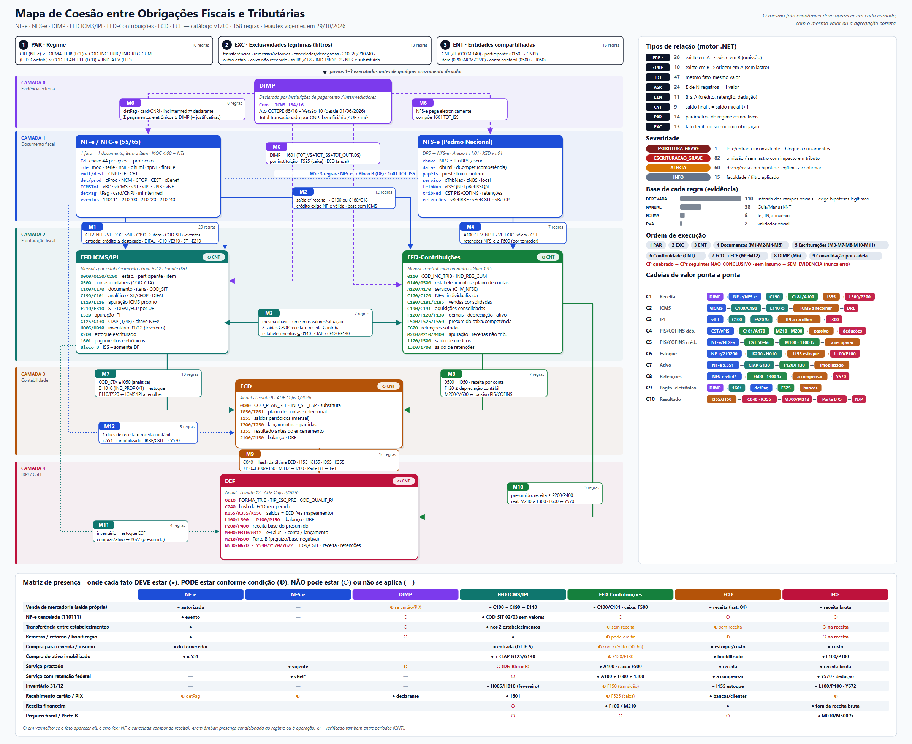

# Base de Regras – Agente de Parecer Técnico Fiscal/Tributário

> Estudo de relações e regras de consistência entre **NF-e, NFS-e, DIMP, ECD, ECF, EFD ICMS/IPI (SPED Fiscal) e EFD-Contribuições**.
> **Papel do agente:** recebe de outros agentes as obrigações **já validadas quanto ao layout** (JSON normalizado + relatório de validação) e verifica **somente as relações entre elas**. Não lê arquivos originais nem refaz validação de estrutura.
> Data de levantamento: **29/10/2026**. Toda regra deste material indica a sua **base** (manual, guia, leiaute, norma) e o seu **tipo de evidência** (ver seção 3).

## 1. Índice

**Visão geral ilustrada:** [imagens/mapa-coesao-obrigacoes.png](imagens/mapa-coesao-obrigacoes.png) (versão vetorial: [.svg](imagens/mapa-coesao-obrigacoes.svg))

**NÚCLEO – relação entre as obrigações (o que deve estar em uma e na outra):**

| Arquivo | Conteúdo |
|---|---|
| [NUCLEO-1-principios-entidades-matriz.md](NUCLEO-1-principios-entidades-matriz.md) | Camadas de complementaridade, tipos de relação (PRE→, ←PRE, IDT, AGR, LIM, CNT, PAR, EXC), entidades compartilhadas (estabelecimento, participante, item, conta, documento), **matriz de presença fato × obrigação** e matriz de compatibilidade de regime |
| [NUCLEO-2-mapas-bidirecionais.md](NUCLEO-2-mapas-bidirecionais.md) | Para cada par de obrigações: A→B (omissão), B→A (sem lastro), **de-para campo a campo** e exclusivos legítimos |
| [NUCLEO-3-cadeias-de-valor.md](NUCLEO-3-cadeias-de-valor.md) | Cadeias ponta a ponta (receita, ICMS, IPI, PIS/COFINS débito e crédito, estoque, ativo, retenções, DIMP, resultado→IRPJ/CSLL) com pontos de controle e ordem de execução |

**Catálogo executável:**

| Arquivo | Conteúdo |
|---|---|
| [regras/README.md](regras/README.md) | Catálogo JSON com 158 regras (schema, fontes, parâmetros, regras por mapa, cadeias e ordem de execução) |

**Estudo (NotebookLM):**

| Arquivo | Conteúdo |
|---|---|
| [notebooklm/INSTRUCOES-NOTEBOOKLM.md](notebooklm/INSTRUCOES-NOTEBOOKLM.md) | Fontes a enviar, instrução do chat, roteiro de estudo, prompt do resumo em áudio |
| [notebooklm/catalogo-regras-legivel.md](notebooklm/catalogo-regras-legivel.md) | As 158 regras do catálogo JSON em texto legível |

**Referência e apoio:**

| Arquivo | Conteúdo |
|---|---|
| [01-panorama-obrigacoes.md](01-panorama-obrigacoes.md) | Base legal, obrigados, escopo e registros/campos-chave de cada obrigação |
| [02-regras-intra-obrigacao.md](02-regras-intra-obrigacao.md) | Regras internas de cada obrigação – executadas pelos agentes de origem; aqui como referência e pré-condições |
| [03-regras-cruzamento.md](03-regras-cruzamento.md) | Catálogo resumido de regras de cruzamento (versão anterior; o detalhamento está no NÚCLEO-2) |
| [04-reforma-tributaria-e-mudancas-2026.md](04-reforma-tributaria-e-mudancas-2026.md) | IBS/CBS, CNPJ alfanumérico e mudanças de leiaute que afetam as regras |
| [05-modelo-regras-agente.md](05-modelo-regras-agente.md) | Modelo de dados das regras, severidade e contrato de saída do agente |

## 2. Versões oficiais vigentes verificadas (fonte primária)

Verificadas diretamente nos portais oficiais em 29/10/2026:

| Obrigação | Documento vigente | Onde foi verificado |
|---|---|---|
| EFD ICMS/IPI | Guia Prático **v3.2.2** (última listada no portal); leiaute **versão 020** (NT 2025.001 v1.0 – válido de 01/01/2026 a 31/12/2026 – Ato COTEPE/ICMS nº 79/2025) | sped.rfb.gov.br/pasta/show/1573 |
| EFD-Contribuições | Guia Prático **v1.35** | sped.rfb.gov.br/pasta/show/1989 |
| ECD | Manual de Orientação do **Leiaute 9** – atualização maio/2026 – anexo ao **ADE Cofis nº 1/2026** (“não houve alteração de leiaute no ano-calendário de 2025”); programa **10.4.1** (19/05/2026) | sped.rfb.gov.br/pasta/show/1569 |
| ECF | **Leiaute 12** (ano-calendário 2025 e situações especiais de 2026) – programa **12.1.6** (25/05/2026) | sped.rfb.gov.br (destaques) |
| NF-e/NFC-e | MOC (leiaute 4.00) + NTs vigentes; destaque: **NT 2025.002 v1.52** (RTC – IBS/CBS/IS, publicada 01/10/2026), **NT 2026.004 v1.01** (CNPJ alfanumérico), **NT 2026.006** (vínculo NF-e x transação financeira – *split payment*), **NT 2026.007 v1.10** (LCC-RFB/CCC), **NT 2023.002 v1.02** (fim da autorização assíncrona/inutilização – 27/10/2026) | nfe.fazenda.gov.br – Documentos > Notas Técnicas |
| NFS-e (Padrão Nacional) | Esquemas **XSD v1.01 (20260209)**; Anexo I – leiaute DPS/NFS-e **v1.01**; Anexo B – NBS/Lista de Serviço Nacional v1.01; Anexo C – indOp IBS/CBS v1.01 | gov.br/nfse – Documentação Atual (atualizado 15/08/2026) |
| DIMP | **Versão 10** da DIMP, efeitos a partir de **01/06/2026** (Ato COTEPE/ICMS 65/18, art. 1º, redação do Ato COTEPE/ICMS 124/25) | confaz.fazenda.gov.br – Ato COTEPE/ICMS 65/18 |

**Pontos não confirmados em fonte primária (tratar como “verificar”):**
- Fontes secundárias citam Guia Prático EFD ICMS/IPI **v3.2.3** (mai/2026) e **v3.2.4** (Ato COTEPE/ICMS nº 86/2026), e leiaute EFD ICMS/IPI 2027 pelo **Ato COTEPE/ICMS 69/2026** (NT 2026.001). Não estavam listados na página oficial consultada.
- Cronograma de obrigatoriedade em produção da regra **UB12-10** (grupo IBS/CBS na NF-e) – conferir a própria NT 2025.002 v1.52.
- Obrigatoriedade da NFS-e Nacional para optantes do Simples Nacional: fontes secundárias citam Res. CGSN 189/2026 e 191/2026 (prorrogação para 01/11/2026). Conferir no DOU.

> **Regra de governança:** o agente de origem deve informar, no JSON de cada obrigação, a **versão de leiaute** declarada (ex.: `0000.COD_VER` na EFD ICMS/IPI, `I010.COD_VER_LC` na ECD, `0000.COD_VER` na ECF, `versao` do XML da NF-e/NFS-e). Este agente aplica somente regras de cruzamento vigentes para aquela versão e período; versão ausente ou não suportada torna a obrigação não apta ao cruzamento.

## 3. Tipos de evidência (como cada regra se sustenta)

Para atender ao requisito “nenhuma informação sem base oficial”, cada regra é marcada com um tipo:

| Tipo | Significado | Confiabilidade para o parecer |
|---|---|---|
| **[PVA]** | Regra de validação aplicada pelo próprio programa validador (PVA) ou pela SEFAZ/Ambiente Nacional na autorização do documento. | Máxima. Se o documento já foi validado, a regra deve estar satisfeita; violação indica arquivo adulterado/versão errada. |
| **[MANUAL]** | Regra descrita textualmente no Guia/Manual/Leiaute/NT (definição de campo, obrigatoriedade, exceção), mas que não necessariamente bloqueia a transmissão. | Alta. |
| **[NORMA]** | Regra decorrente de lei, IN, Convênio, Ajuste SINIEF. | Alta. |
| **[DERIVADA]** | Regra de cruzamento **inferida** da definição oficial dos campos de duas obrigações distintas (ex.: o mesmo documento fiscal deve aparecer nas duas escriturações). Os manuais não trazem a regra “cruzada” explícita, mas os dois lados estão definidos oficialmente. | Média-alta. Sempre deve gerar **ALERTA** ou **ERRO** com espaço para justificativa (ex.: diferença temporal, regime, exceção). |

O agente **não deve** emitir conclusão de “irregularidade” fundada apenas em regra [DERIVADA] sem relatar as hipóteses legítimas listadas na própria regra.

## 4. Escala de severidade

| Nível | Código | Critério |
|---|---|---|
| Erro grave de estrutura | `ESTRUTURA_GRAVE` | Detectado pelos **agentes de origem** (registro obrigatório ausente, versão errada, totalizador que não fecha em regra [PVA]). Neste agente aparece como "pré-condição de entrada não atendida": a obrigação não é cruzada e os cruzamentos dependentes viram "ausência de evidências". |
| Erro grave de escrituração | `ESCRITURACAO_GRAVE` | Estrutura válida, mas o conteúdo diverge de outra obrigação/documento com **impacto em tributo ou base de cálculo** (omissão de documento, débito menor que o destacado, receita omitida, saldo contábil divergente). |
| Alerta de atenção | `ALERTA` | Divergência que **pode** ter explicação legítima (competência x caixa, data de entrada x emissão, CFOP sem receita, exceções do Guia) e exige análise humana/justificativa. |
| Informativo | `INFO` | Constatação sem indício de erro (ex.: uso de faculdade prevista no Guia). |

## 5. Fontes oficiais

- Portal SPED – EFD ICMS/IPI (Manuais e Guias): http://sped.rfb.gov.br/pasta/show/1573
- Portal SPED – EFD-Contribuições (Manuais): http://sped.rfb.gov.br/pasta/show/1989
- Portal SPED – ECD (Manuais): http://sped.rfb.gov.br/pasta/show/1569
- Portal SPED – ECF: http://sped.rfb.gov.br/projeto/show/269
- Portal Nacional da NF-e – Notas Técnicas: https://www.nfe.fazenda.gov.br/portal/listaConteudo.aspx?tipoConteudo=04BIflQt1aY=
- Portal NFS-e – Documentação Técnica Atual: https://www.gov.br/nfse/pt-br/biblioteca/documentacao-tecnica/documentacao-atual
- CONFAZ – Ato COTEPE/ICMS 65/18 (DIMP): https://www.confaz.fazenda.gov.br/legislacao/atos/2018/ato-cotepe-icms-65-18
- CONFAZ – Manuais: https://www.confaz.fazenda.gov.br/legislacao/arquivo-manuais

> **Limite deste estudo:** os números de registro/campo citados seguem os leiautes vigentes listados acima. Antes de codificar cada regra, o time deve conferir o campo no PDF da versão correspondente (o agente deve tratar o catálogo de regras como dado versionado, não como código fixo).
