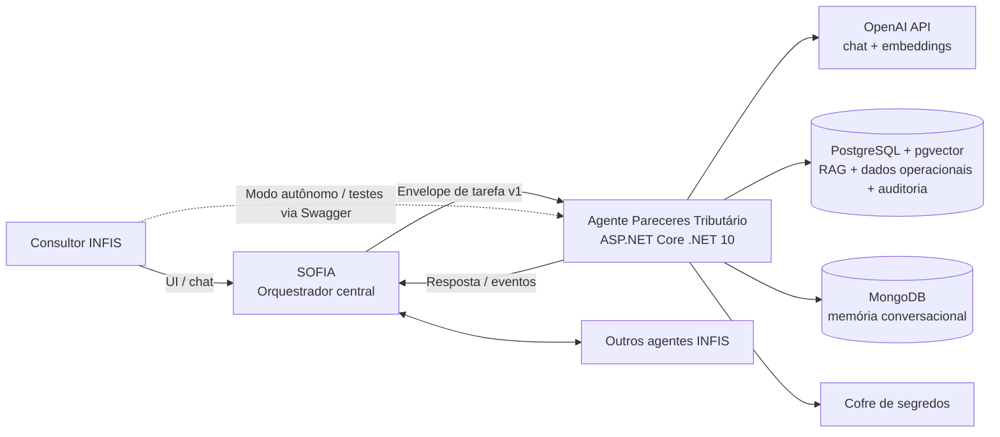
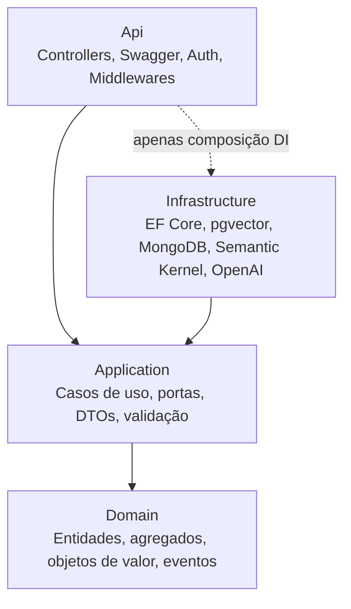
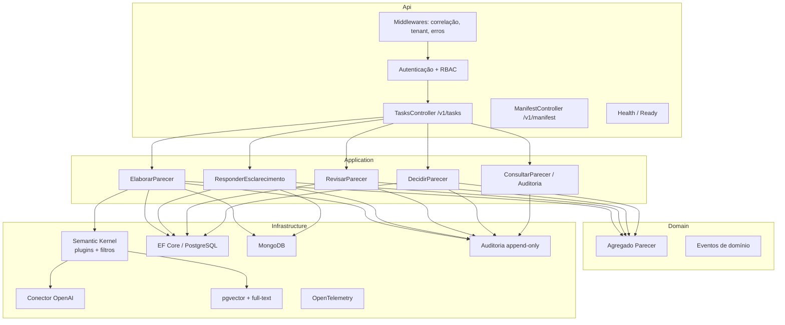
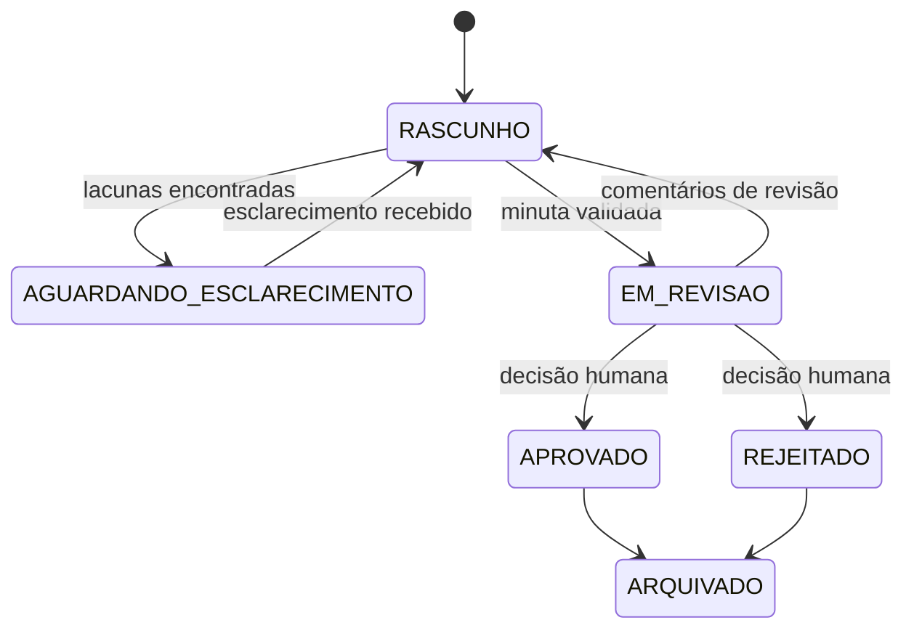

# Arquitetura — Agente Pareceres Tributário

> Subordinado a [`constitution.md`](constitution.md) e [`requirements.md`](requirements.md). Descreve a arquitetura **alvo**. Nenhum código é implementado nesta etapa (Fase 0).

| Campo | Valor |
|---|---|
| Responsável | Roberto |
| Versão | 0.2.0 (rascunho) |
| Plataforma | .NET 10 · ASP.NET Core Web API |
| Estilo | Clean Architecture · DDD · SOLID |
| IA | Semantic Kernel · OpenAI · RAG com pgvector |
| Memória conversacional | MongoDB |
| Documentação de API | OpenAPI + Swagger UI |
| Testes | xUnit |

---

## 1. Stack tecnológica

| Aspecto | Tecnologia | Observação |
|---|---|---|
| Runtime | .NET 10 (LTS) | C# 14 |
| API | ASP.NET Core Web API (Controllers) | Versionamento por rota (`/v1/...`) |
| Documentação da API | `Microsoft.AspNetCore.OpenApi` (geração do documento) + Swagger UI | Swagger UI habilitado apenas em dev/hml e protegido por autenticação |
| Orquestração de IA | Microsoft Semantic Kernel | Kernel por requisição, plugins, filtros e conectores |
| LLM | OpenAI (chat completion + embeddings) via conector do Semantic Kernel | Modelos configuráveis; provedor abstraído (RNF-041) |
| RAG / busca vetorial | PostgreSQL + extensão **pgvector** | Busca híbrida: vetorial (HNSW) + full-text em português |
| Banco operacional | PostgreSQL (EF Core + Npgsql) | Pareceres, versões, decisões, auditoria |
| Memória conversacional | MongoDB (`MongoDB.Driver`) | Histórico de sessão por tenant + sessão |
| Validação | FluentValidation + JSON Schema dos contratos | Entrada e saída validadas |
| Observabilidade | `ILogger` (logs JSON) + OpenTelemetry | Traces, métricas e logs correlacionados |
| Segredos | Cofre de segredos (ex.: Azure Key Vault); `dotnet user-secrets` apenas em dev | Nunca em `appsettings*.json` versionados |
| Testes | xUnit + NSubstitute + Testcontainers + `WebApplicationFactory` + NetArchTest | Unitários, integração, contrato, arquitetura e avaliação |
| Empacotamento | Docker | Um contêiner por agente (RNF-014) |

> **Licenças:** evitar bibliotecas que passaram a exigir licença comercial (ex.: MediatR v13+, FluentAssertions v8+, AutoMapper v15+). Casos de uso são orquestrados por *handlers* próprios e o mapeamento é explícito.

## 2. Visão de contexto



**Regras de fronteira:**
- O agente **não** chama outros agentes diretamente; toda coordenação passa por SOFIA (P6).
- O modo autônomo usa **o mesmo contrato** do modo orquestrado (RF-045).
- A base normativa é compartilhada e somente leitura; dados de clientes ficam segregados por tenant (RNF-011, RNF-012).
- PostgreSQL e MongoDB são **exclusivos** deste agente; nenhum outro agente acessa esses bancos.

## 3. Clean Architecture

### 3.1 Camadas e regra de dependência

As dependências apontam sempre **para dentro**. O Domínio não conhece nenhuma tecnologia (nem Semantic Kernel, nem EF Core, nem MongoDB, nem OpenAI).



| Camada | Projeto | Responsabilidade | Pode depender de |
|---|---|---|---|
| Domain | `Infis.PareceresTributario.Domain` | Modelo de domínio, invariantes, eventos de domínio, interfaces de repositório | Nada |
| Application | `Infis.PareceresTributario.Application` | Casos de uso, portas (interfaces) para IA, busca, memória, auditoria; DTOs; validação | Domain |
| Infrastructure | `Infis.PareceresTributario.Infrastructure` | Adaptadores: EF Core/PostgreSQL, pgvector, MongoDB, Semantic Kernel/OpenAI, cofre, OpenTelemetry | Application, Domain |
| Api | `Infis.PareceresTributario.Api` | Endpoints HTTP, contratos SOFIA, autenticação/RBAC, Swagger, *composition root* | Application (e Infrastructure só para registrar DI) |
| Contracts | `Infis.PareceresTributario.Contracts` | DTOs públicos versionados do envelope SOFIA (espelham os JSON Schemas) | Nada |

A regra de dependência é verificada automaticamente por testes de arquitetura (NetArchTest) em `tests/`.

### 3.2 Portas da Application (implementadas na Infrastructure)

| Porta (interface) | Adaptador | Requisitos |
|---|---|---|
| `IParecerRepository` | EF Core + PostgreSQL (filtro por tenant obrigatório) | RF-030, RNF-010 |
| `IPesquisaNormativa` | Semantic Kernel + pgvector + full-text | RF-010 a RF-013 |
| `IGeradorMinuta` | Semantic Kernel + OpenAI chat completion | RF-020, RF-022 |
| `IAnalisadorLacunas` | Semantic Kernel + OpenAI chat completion | RF-003 |
| `IValidadorCitacoes` | Consulta à base normativa (pgvector/SQL) | RF-021, RNF-032 |
| `IMemoriaConversacional` | MongoDB | RNF-013 |
| `IAuditoria` | Tabela append-only no PostgreSQL | RF-050 a RF-053 |
| `IExtratorDocumentos` | Bibliotecas de leitura PDF/DOCX/TXT | RF-004 |
| `IPublicadorEventos` | Adaptador de mensageria SOFIA (a definir) | RF-046 |
| `IRelogio`, `IContextoExecucao` | Implementações de sistema | Testabilidade, correlação |

### 3.3 Visão de componentes



## 4. Domain-Driven Design

### 4.1 Contexto delimitado

**Pareceres Tributários** — contexto próprio, com linguagem ubíqua própria. Integra-se a outros contextos (outros agentes INFIS) somente por SOFIA, por meio de contratos publicados e de uma **camada anticorrupção** na Api/Infrastructure.

### 4.2 Linguagem ubíqua

| Termo | Significado |
|---|---|
| Consulta | Pergunta tributária com fatos, tributos, esfera e período |
| Parecer | Documento técnico com conclusão fundamentada; agregado raiz |
| Minuta | Versão de parecer ainda não aprovada por humano |
| Versão | Fotografia imutável do conteúdo do parecer |
| Referência | Fonte normativa citada (lei, IN, solução de consulta, acórdão) com vigência |
| Lacuna | Fato essencial ausente que impede a análise |
| Esclarecimento | Pergunta ao consultor para preencher uma lacuna |
| Decisão humana | Aprovação ou rejeição por usuário autorizado |
| Data-base | Data de referência normativa da análise |
| Sessão | Conversa explícita de um consultor sobre um parecer, com memória própria |

### 4.3 Modelo de domínio

**Agregado `Parecer` (raiz)**
- Entidades internas: `VersaoParecer` (imutável), `DecisaoHumana`.
- Objetos de valor: `ParecerId`, `TenantId`, `CorrelationId`, `Consulta`, `Referencia`, `DataBase`, `GrauConfianca`, `NivelRisco`, `Esfera`, `Tributo`, `StatusParecer`, `UsuarioId`.
- Invariantes:
  - Todo `Parecer` pertence a exatamente um `TenantId`, que não muda.
  - Transições de estado seguem a máquina de estados (4.4); transições inválidas lançam exceção de domínio.
  - `Aprovar` exige `DecisaoHumana` com `UsuarioId` de papel `revisor` — nunca uma identidade de serviço (RF-031).
  - Uma `VersaoParecer` não pode ser publicada se alguma afirmação não tiver `Referencia` (RF-021).
  - Versões anteriores nunca são alteradas; revisões geram nova versão (RF-032).
- Eventos de domínio: `MinutaGerada`, `EsclarecimentoSolicitado`, `VersaoCriada`, `ParecerAprovado`, `ParecerRejeitado`.

**Fora do agregado**
- `RegistroAuditoria` — preocupação transversal, gravado pela Application via `IAuditoria`; não é entidade de domínio editável.
- `Sessao` / histórico conversacional — modelo de aplicação persistido no MongoDB; **não** é fonte normativa e nunca pode ser citado como referência.

### 4.4 Máquina de estados



## 5. Aplicação dos princípios SOLID

| Princípio | Aplicação no agente |
|---|---|
| **S** — Responsabilidade única | Cada caso de uso é um *handler*; cada plugin do Semantic Kernel faz uma coisa (pesquisar, gerar, validar); controllers só traduzem HTTP ↔ caso de uso |
| **O** — Aberto/fechado | Novos tipos de parecer entram por novos templates de prompt e estratégias, sem alterar o fluxo central |
| **L** — Substituição de Liskov | Qualquer implementação de `IPesquisaNormativa`, `IMemoriaConversacional` etc. (real, fake ou de teste) respeita o mesmo contrato e as mesmas pós-condições |
| **I** — Segregação de interfaces | Portas pequenas e específicas (`IGeradorMinuta`, `IAnalisadorLacunas`, `IValidadorCitacoes`) em vez de um "serviço de IA" genérico |
| **D** — Inversão de dependência | Application depende de abstrações; a Infrastructure implementa; a Api compõe tudo via injeção de dependência nativa do ASP.NET Core |

## 6. Semantic Kernel

### 6.1 Uso
- **Kernel por requisição** (escopo *scoped* no DI): nenhum estado de kernel, histórico ou plugin é compartilhado entre requisições ou tenants (P3, RNF-013).
- **Orquestração determinística na Application:** a sequência *lacunas → pesquisa → geração → validação* é controlada pelo caso de uso, não pela escolha livre do modelo. O *function calling* automático, se usado, fica limitado a plugins **somente leitura**.
- **Conectores:** OpenAI para chat completion e geração de embeddings; armazenamento vetorial PostgreSQL/pgvector.

### 6.2 Plugins previstos

| Plugin | Funções | Efeito colateral |
|---|---|---|
| `PesquisaNormativaPlugin` | buscar normas, buscar jurisprudência, obter dispositivo | Nenhum (leitura) |
| `DocumentosClientePlugin` | buscar trechos nos anexos do tenant atual | Nenhum (leitura, filtrado por tenant) |
| `ValidacaoCitacaoPlugin` | verificar existência e vigência de uma referência | Nenhum (leitura) |

Nenhum plugin grava dados, envia comunicação externa ou muda o estado do parecer: isso é responsabilidade exclusiva dos casos de uso.

### 6.3 Filtros (segurança e auditoria)
- **Filtro de renderização de prompt:** delimita conteúdo não confiável (anexos, mensagens de outros agentes, histórico) e bloqueia segredos/dados pessoais desnecessários (RNF-005, RNF-006).
- **Filtro de invocação de função:** registra em auditoria cada função chamada, argumentos (hash), duração e resultado; garante que o `tenant_id` da função é o da requisição.
- **Filtro de saída:** valida a resposta do modelo contra schema estruturado antes de chegar à Application.

### 6.4 Prompts
- Prompts e templates versionados em `prompts/` (fora do código), com identificador e versão registrados em cada geração (RNF-040, RF-051).
- Saídas do modelo solicitadas em formato estruturado (JSON) e desserializadas para DTOs tipados.

## 7. LLM — OpenAI

- Acesso via conector OpenAI do Semantic Kernel, atrás das portas da Application (troca de provedor sem alterar o domínio — RNF-041).
- Modelos de chat e de embeddings definidos por configuração; nome e versão do modelo gravados na auditoria.
- Chave de API obtida do cofre de segredos; nunca em configuração versionada ou logs.
- **Proteção de dados (a validar com compliance):** uso da API (sem uso de dados para treinamento), avaliação de *Zero Data Retention* e de residência de dados; alternativa equivalente: Azure OpenAI.
- Envio ao modelo somente dos dados mínimos necessários; dados pessoais mascarados quando não essenciais à análise.
- Controles de custo: limite de tokens por requisição, *timeouts*, *retries* com *backoff* e métrica de consumo por tenant (RNF-021).

## 8. RAG com pgvector

### 8.1 Organização dos dados

| Coleção / tabela | Conteúdo | Acesso |
|---|---|---|
| `normas_publicas` | Legislação, INs, soluções de consulta, jurisprudência (chunks + embeddings + metadados) | Compartilhada, **somente leitura** em runtime; escrita apenas pelo pipeline de ingestão |
| `documentos_cliente` | Chunks de anexos dos clientes | Coluna `tenant_id` obrigatória + **Row-Level Security** no PostgreSQL |

### 8.2 Metadados obrigatórios por chunk normativo
`fonte_id`, `tipo` (lei, decreto, IN, SC, acórdão), `orgao`, `esfera`, `uf`, `municipio`, `dispositivo`, `vigencia_inicio`, `vigencia_fim`, `situacao` (vigente/revogada/alterada), `consultado_em`, `modelo_embedding`, `versao_ingestao`.

### 8.3 Recuperação
- **Busca híbrida:** similaridade vetorial (índice HNSW, distância de cosseno) + full-text PostgreSQL com dicionário `portuguese`, combinados por *reciprocal rank fusion*.
- Filtros por metadados (esfera, UF, tributo, vigência na data-base) aplicados **antes** da similaridade.
- O modelo de embedding é versionado; troca de modelo exige reindexação completa.
- Cada trecho recuperado vira uma `Referencia` candidata; somente referências aprovadas pelo Validador de Citações entram na minuta.

## 9. Memória conversacional — MongoDB

### 9.1 Escopo
- Guarda o histórico de interação de uma **sessão explícita** (`sessao_id`) de um consultor sobre um parecer, para permitir esclarecimentos e revisões em múltiplos turnos.
- Sem `sessao_id` explícito no envelope, nenhuma memória é carregada (RNF-013).
- A memória é **contexto de conversa**, nunca fonte normativa: nada vindo dela pode ser citado como referência.

### 9.2 Modelo do documento (coleção `sessoes_conversa`)
```json
{
  "_id": "sessao_id",
  "tenant_id": "string",
  "parecer_id": "uuid",
  "usuario_id": "string",
  "criada_em": "ISO-8601",
  "atualizada_em": "ISO-8601",
  "expira_em": "ISO-8601",
  "resumo": "string | null",
  "mensagens": [
    { "papel": "consultor | agente", "conteudo": "string", "correlation_id": "uuid", "em": "ISO-8601" }
  ]
}
```

### 9.3 Regras
- Índice composto `{ tenant_id, _id }`; toda consulta filtra por `tenant_id` no adaptador (nunca no chamador).
- Índice TTL em `expira_em`, conforme política de retenção (RNF-007, a definir em T-007).
- Históricos longos são resumidos (`resumo`) para limitar tokens; o resumo é tratado como conteúdo não confiável.
- Criptografia em repouso; usuário de banco com permissão apenas nesta base.
- A trilha de auditoria **não** fica no MongoDB: a memória pode expirar, a auditoria não.

## 10. Contratos de integração (SOFIA)

> **Proposta.** O contrato oficial do SOFIA ainda não está definido. O agente adota o envelope abaixo e o adaptará por meio de uma camada anticorrupção quando o contrato oficial existir. Os DTOs ficam no projeto `Contracts` e são publicados no documento OpenAPI.

### 10.1 Envelope de requisição (`v1`)
```json
{
  "contract_version": "1.0.0",
  "message_id": "uuid",
  "correlation_id": "uuid",
  "causation_id": "uuid | null",
  "source_agent": "sofia",
  "target_agent": "pareceres-tributario",
  "tenant_id": "string (obrigatório)",
  "sessao_id": "string | null",
  "requested_by": { "user_id": "string", "roles": ["consultor"] },
  "task": "parecer.elaborar",
  "payload": {
    "pergunta": "string",
    "fatos": "string",
    "tributos": ["ICMS"],
    "esfera": "federal | estadual | municipal",
    "uf": "SP",
    "municipio": null,
    "periodo_referencia": "2026-01",
    "anexos": [{ "document_id": "string", "tipo": "pdf" }]
  },
  "constraints": { "deadline": "ISO-8601 | null", "fontes_restritas": [] },
  "timestamp": "ISO-8601 UTC"
}
```

### 10.2 Envelope de resposta (`v1`)
```json
{
  "contract_version": "1.0.0",
  "message_id": "uuid",
  "correlation_id": "uuid (mesmo da requisição)",
  "tenant_id": "string",
  "sessao_id": "string | null",
  "agent": { "id": "pareceres-tributario", "version": "0.1.0" },
  "status": "AGUARDANDO_ESCLARECIMENTO | EM_REVISAO | ERRO",
  "result": {
    "parecer_id": "uuid",
    "versao": 1,
    "minuta_markdown": "string",
    "confianca": "alto | medio | baixo",
    "risco": "alto | medio | baixo",
    "data_base": "YYYY-MM-DD",
    "referencias": [{ "id": "string", "tipo": "lei | in | sc | acordao", "dispositivo": "string", "vigencia": "string", "consultado_em": "ISO-8601" }],
    "perguntas_esclarecimento": [],
    "ressalvas": []
  },
  "error": null,
  "audit_ref": "string"
}
```

### 10.3 Endpoints

| Método | Rota | Descrição | Papel |
|---|---|---|---|
| `POST` | `/v1/tasks` | Recebe envelope de tarefa (síncrono ou `202 Accepted` assíncrono) | serviço SOFIA, consultor |
| `GET` | `/v1/tasks/{message_id}` | Status de tarefa assíncrona | serviço SOFIA, consultor |
| `GET` | `/v1/manifest` | Manifesto de capacidades | serviço SOFIA |
| `GET` | `/health`, `/ready` | Saúde e prontidão | infraestrutura |
| `GET` | `/swagger` | Swagger UI (somente dev/hml) | desenvolvedor autenticado |

Erros seguem **Problem Details (RFC 9457)**, sempre com `correlation_id`.

### 10.4 Tarefas suportadas (manifesto)

| `task` | Descrição |
|---|---|
| `parecer.elaborar` | Gera nova minuta |
| `parecer.esclarecer` | Envia respostas a perguntas de esclarecimento |
| `parecer.revisar` | Envia comentários e gera nova versão |
| `parecer.decidir` | Aprova/rejeita (somente identidade humana) |
| `parecer.consultar` | Retorna parecer, versões e status |
| `auditoria.consultar` | Retorna trilha de auditoria |

### 10.5 Eventos emitidos
`parecer.minuta_gerada`, `parecer.esclarecimento_solicitado`, `parecer.versao_criada`, `parecer.aprovado`, `parecer.rejeitado`. Eventos carregam `correlation_id`, `tenant_id` e `parecer_id` e **não** carregam o conteúdo integral do parecer. São gerados a partir dos eventos de domínio e publicados após a confirmação da transação (padrão *outbox*).

### 10.6 Versionamento
SemVer no `contract_version` e versão na rota (`/v1`). Mudança incompatível → nova versão maior, com suporte simultâneo à anterior por período acordado com o time de SOFIA.

## 11. Persistência (PostgreSQL)

| Tabela | Campos principais | Observação |
|---|---|---|
| `pareceres` | `parecer_id`, `tenant_id`, `status`, `criado_por`, `criado_em` | RLS por tenant |
| `versoes_parecer` | `parecer_id`, `versao`, `conteudo`, `modelo`, `prompt_version`, `criado_em` | Imutável |
| `referencias` | `id`, `parecer_id`, `versao`, `tipo`, `dispositivo`, `trecho`, `vigencia`, `consultado_em` | Vinculada à versão |
| `decisoes_humanas` | `parecer_id`, `versao`, `decisao`, `user_id`, `justificativa`, `em` | Obrigatória para `APROVADO` |
| `outbox_eventos` | `id`, `tipo`, `payload`, `publicado_em` | Publicação confiável de eventos |
| `auditoria` | `audit_id`, `correlation_id`, `tenant_id`, `evento`, `hash_entrada`, `hash_saida`, `metadados`, `em`, `hash_anterior` | Append-only, encadeada por hash |

Os repositórios EF Core aplicam *global query filter* por `tenant_id`, além da RLS no banco (defesa em profundidade).

## 12. Isolamento

| Camada | Mecanismo |
|---|---|
| Requisição | `tenant_id` obrigatório; middleware confronta com o escopo do token |
| Contexto de execução | `IContextoExecucao` *scoped* com `tenant_id`, `correlation_id`, `usuario_id` |
| PostgreSQL | *Global query filter* EF Core + Row-Level Security |
| pgvector | `normas_publicas` somente leitura; `documentos_cliente` com RLS por tenant |
| MongoDB | Filtro por `tenant_id` no adaptador; memória somente com `sessao_id` explícito |
| Semantic Kernel | Kernel e histórico por requisição; filtros verificam o tenant nas chamadas de função |
| Execução | Contêiner próprio, conta de serviço própria, credenciais próprias por banco |
| Ambientes | dev / hml / prd separados; dados sintéticos fora de produção |

## 13. Segurança

- **Autenticação:** JWT Bearer — token de serviço (ou mTLS) para SOFIA; OIDC para usuários humanos (IdP a definir em T-006).
- **Autorização:** políticas do ASP.NET Core por papel — `consultor` (elaborar, revisar), `revisor` (decidir), `auditor` (consultar auditoria), `admin` (configuração).
- **Swagger:** desabilitado em produção; em dev/hml exige autenticação.
- **Segredos:** cofre de segredos; `appsettings*.json` versionados contêm apenas placeholders.
- **Prompt injection:** filtros do Semantic Kernel delimitam conteúdo não confiável; instruções de sistema nunca derivam de anexos, memória ou mensagens de outros agentes; saída validada contra schema.
- **Dados pessoais:** mascaramento em logs; minimização no envio ao LLM.
- **Proteções HTTP:** HTTPS obrigatório, *rate limiting* nativo do ASP.NET Core, limite de tamanho de requisição e de anexos.
- **Validação de saída:** toda resposta passa por validação de schema e pelo Validador de Citações.

## 14. Auditoria

- Registro em cada etapa: recebimento, esclarecimento, pesquisa, chamada ao LLM, validação, decisão humana, erro.
- Tabela `auditoria` com usuário de banco que tem apenas permissão de `INSERT` e *trigger* que impede `UPDATE`/`DELETE`.
- Encadeamento por hash (`hash_anterior`) para detectar adulteração.
- Conteúdo sensível armazenado cifrado; logs técnicos contêm apenas hashes e IDs.
- Cada geração registra: modelo OpenAI e versão, versão do prompt, modelo de embedding, fontes recuperadas e fontes efetivamente citadas.

## 15. Estratégia de testes (xUnit)

| Projeto | Escopo | Ferramentas |
|---|---|---|
| `Domain.Tests` | Invariantes, máquina de estados, objetos de valor | xUnit |
| `Application.Tests` | Casos de uso com portas substituídas por *fakes* | xUnit + NSubstitute |
| `Infrastructure.Tests` | Repositórios, RLS, pgvector, MongoDB, isolamento entre tenants | xUnit + Testcontainers (PostgreSQL/pgvector, MongoDB) |
| `Api.Tests` | Endpoints, autenticação, RBAC, Problem Details, contratos | xUnit + `WebApplicationFactory` |
| `Architecture.Tests` | Regra de dependência da Clean Architecture | xUnit + NetArchTest |
| `Evaluation.Tests` | Golden set de pareceres e taxa de citações inválidas | xUnit (execução manual/agendada, com LLM real) |

- Testes unitários e de integração **não** chamam a OpenAI; usam *fakes* das portas.
- Testes de isolamento entre tenants são obrigatórios e rodam em todo CI (RNF-010, RNF-011).

## 16. Decisões arquiteturais (ADRs)

| ADR | Decisão | Status |
|---|---|---|
| ADR-001 | Comunicação com outros agentes somente via SOFIA | Aceita (constituição P6) |
| ADR-002 | Camada anticorrupção para o contrato SOFIA | Proposta |
| ADR-003 | Auditoria append-only encadeada por hash no PostgreSQL | Proposta |
| ADR-004 | RAG com validação obrigatória de citações | Proposta |
| ADR-005 | .NET 10 + ASP.NET Core Web API com Clean Architecture e DDD | Aceita |
| ADR-006 | Semantic Kernel como camada de orquestração de IA, isolado na Infrastructure | Aceita |
| ADR-007 | OpenAI como provedor de LLM e embeddings, atrás de portas da Application | Aceita (pendente de validação de compliance) |
| ADR-008 | PostgreSQL + pgvector para RAG com busca híbrida | Aceita |
| ADR-009 | MongoDB para memória conversacional por sessão, separada da auditoria | Aceita |
| ADR-010 | Swagger UI apenas em dev/hml, com autenticação | Proposta |
| ADR-011 | xUnit como framework de testes, com Testcontainers para integração | Aceita |

> **Ponto de atenção (ADR-006):** a Microsoft está evoluindo o Semantic Kernel para o *Microsoft Agent Framework*. Como o SK fica isolado na Infrastructure, uma eventual migração não afeta Domain nem Application. Reavaliar na Fase 3.

## 17. Estrutura de diretórios prevista

```
infis-agente-pareceres-tributario/
├── AGENTS.md
├── Infis.PareceresTributario.sln
├── specs/                                   # Especificações SDD (fonte da verdade)
├── docs/                                    # Documentação complementar, ADRs
├── samples/                                 # Consultas e pareceres de exemplo (dados sintéticos)
├── contracts/                               # JSON Schemas versionados
├── prompts/                                 # Prompts e templates versionados
├── src/
│   ├── Infis.PareceresTributario.Domain/
│   ├── Infis.PareceresTributario.Application/
│   ├── Infis.PareceresTributario.Infrastructure/
│   ├── Infis.PareceresTributario.Contracts/
│   └── Infis.PareceresTributario.Api/
└── tests/
    ├── Infis.PareceresTributario.Domain.Tests/
    ├── Infis.PareceresTributario.Application.Tests/
    ├── Infis.PareceresTributario.Infrastructure.Tests/
    ├── Infis.PareceresTributario.Api.Tests/
    ├── Infis.PareceresTributario.Architecture.Tests/
    └── Infis.PareceresTributario.Evaluation.Tests/
```

## 18. Histórico de versões

| Versão | Data | Autor | Alteração |
|---|---|---|---|
| 0.1.0 | 2026-10-22 | Roberto | Versão inicial (stack em aberto) |
| 0.2.0 | 2026-10-22 | Roberto | Stack definida: .NET 10, Clean Architecture, DDD, SOLID, Semantic Kernel, OpenAI, pgvector, MongoDB, Swagger, xUnit |
